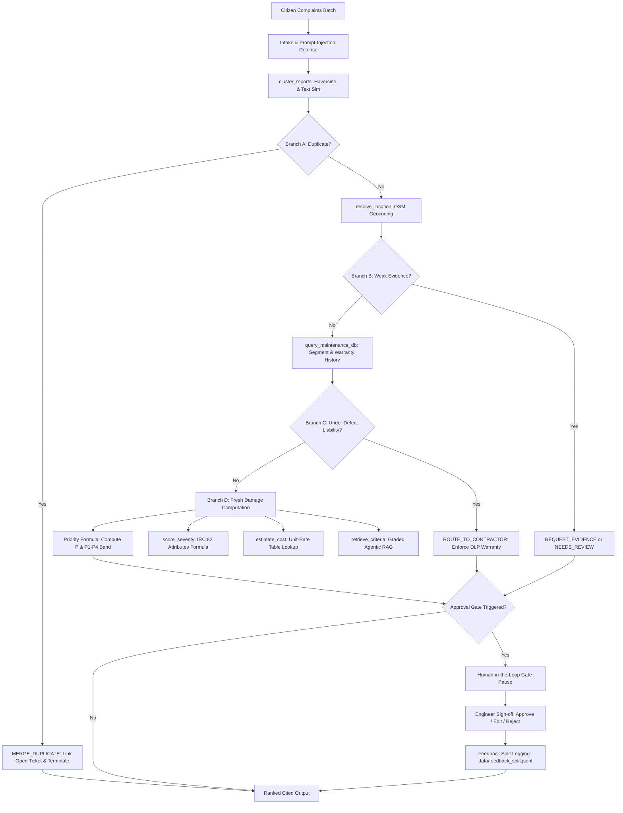

# 🚧 Road-Damage Repair Prioritization Agent
**Civic Infrastructure & Urban Planning Domain (Bengaluru Ward 34 · D.V. Gundappa Ward)**  
*Agentic AI Mini-Project (26CD7PEAAI) · Review 2 Implementation Codebase*  
*Department of CSE (Data Science), BMS College of Engineering (BMSCE)*

---

## 📌 Executive Summary

Municipal ward engineers receive hundreds of pothole complaints every monsoon. In practice:
1. Many reports are **duplicates** of each other or repeat an already active ticket.
2. Many reports are **too vague** to dispatch crews without GPS pins or photographs.
3. Several complaints concern road segments that were recently surfaced and are still under the contractor's **statutory Defect Liability Period (DLP)**, resulting in duplicate municipal payments if new work orders are issued.

This system is an **internal decision-support agent** for municipal engineers. It does **not** communicate directly with citizens; rather, it automatically aggregates complaint clusters for a ward, executes deterministic engineering tools, grounds decisions in municipal policy guidelines (**IRC:82** and **BBMP 2021 Tender Conditions**), and routes each cluster to one of six mutually exclusive outcomes with advisory priority levels.

---

## 🏛️ System Architecture & 4 Decision Branches

The agent operates as a **bounded LangGraph workflow** integrating a visible ReAct reasoning loop (`Thought`, `Action`, `Observation`), agentic RAG with chunk grading and fallback rules, and an approval gate with durable SQLite checkpointing.



### The 4 Decision Branches:
- **Branch A (`MERGE_DUPLICATE`):** Matches active open tickets (`distance <= 45m`, `time window <= 14d`, `text similarity >= 0.40`). Bypasses scoring, maintenance history, and retrieval, immediately ending the run to eliminate double-spend.
- **Branch B (`REQUEST_EVIDENCE` / `NEEDS_REVIEW`):** Location cannot be resolved from GPS coordinates or street landmarks. Prevents hallucinating road segments and pauses for photographic proof or pin.
- **Branch C (`ROUTE_TO_CONTRACTOR`):** Repair history reveals the segment was surfaced within its statutory defect liability period (3 years for layers >40mm, 2 years under 40mm). Damage is routed directly to the original contractor at zero municipal cost under BBMP Tender Clause 14.5.
- **Branch D (Fresh Damage: `INSPECT` or `REPAIR_NOW`):** Evaluates physical severity (0-1) against road-class action thresholds (Arterial: 0.65, Sub-Arterial: 0.70, Collector: 0.75, Local: 0.85). Computes repair expenditure and assigns priority ($P1$ to $P4$).

---

## 🛠️ The Seven Deterministic Python Tools

In adherence to strict engineering guardrails, **the LLM never calculates numbers**. The LLM extracts qualitative physical attributes; deterministic Python tools perform all computations:

| # | Tool Function | Operational Responsibility | Grounding Source |
|---|---|---|---|
| 1 | `resolve_location` | Geocodes lat/lon or textual landmarks to OSM road segments and road class | Ward 34 OSM Overpass extract (`data/osm_ward34.json`) |
| 2 | `cluster_reports` | Merges reports via Haversine distance ($\le 35$m), time window ($\le 7$d), and TF-IDF similarity ($\ge 0.55$); detects open ticket duplicates | Python spatial-temporal clustering + SQLite ticket index |
| 3 | `score_severity` | Computes severity score from 0.0 to 1.0 based on depth, area, water ponding, and wheel path placement | Rule-based engine grounded in **IRC:82 Section 4.3** |
| 4 | `query_maintenance_db`| Queries historical paving records, layer thickness, contractor name, and calculates remaining liability days | SQLite maintenance database (`data/maintenance_db.sqlite`) |
| 5 | `estimate_cost` | Calculates repair expenditure from patch area, depth, and road-class multipliers; checks 25,000 INR cost gate | Unit-rate table (₹1,200/m² baseline from Deccan Herald/BBMP) |
| 6 | `retrieve_criteria` | Queries municipal corpus, executes chunk grading, rewrites queries if weak, and falls back to default rule table | Agentic RAG over IRC:82 and BBMP Tender Specifications |
| 7 | `request_approval` | Evaluates the 4 statutory gate triggers and packages payloads for the human interrupt gate | LangGraph interrupt mechanism |

### Priority Formula (Section 3.2):
For `INSPECT` and `REPAIR_NOW`, the priority score $P$ is computed deterministically:
$$P = c_{road} \times (w_s \cdot S + w_t \cdot T + w_h \cdot H + w_r \cdot R)$$
- $S$: Severity score ($0.0 - 1.0$)
- $T$: Traffic index ($0.0 - 1.0$)
- $H$: Historical pavement risk ($0.0 - 1.0$)
- $R$: Normalized de-duplicated complaint volume
- $c_{road}$: Road-class factor (Arterial: $1.30$, Sub-Arterial: $1.15$, Collector: $1.00$, Local: $0.85$)
- Weights: $w_s = 0.40, w_t = 0.30, w_h = 0.15, w_r = 0.15$ ($\sum w = 1.0$)

**Priority Bands:**
- **P1 (Score $\ge 0.80$):** Emergency repair within 24 hours (Mandatory engineer sign-off).
- **P2 ($0.60 \le \text{Score} < 0.80$):** Urgent redressal within 48 hours.
- **P3 ($0.40 \le \text{Score} < 0.60$):** Routine maintenance within 7 days.
- **P4 (Score $< 0.40$):** Scheduled cyclic maintenance within 30 days.

---

## 🚦 Human-in-the-Loop Approval Gate (Section 4)

Execution automatically pauses and creates a durable checkpoint in SQLite whenever any of the **4 statutory triggers** fire:
1. `REPAIR_NOW` with priority **P1** (Emergency public safety dispatch).
2. Any `ROUTE_TO_CONTRACTOR` (Imposes binding contractual warranty liabilities).
3. Any `NEEDS_REVIEW` (Safety fallback for conflicting evidence or ungrounded claims).
4. Estimated repair expenditure exceeds **₹25,000** (Cost gate threshold).

**Engineer Action Logging:** When the engineer reviews, approves, edits, or rejects the order, their action is appended to `data/feedback_split.jsonl` to provide a clean feedback loop for subsequent tuning without contaminating the held-out evaluation set.

---

## 📁 Repository Directory Structure

```
├── agent/
│   ├── __init__.py
│   ├── graph.py             # Bounded LangGraph workflow with SQLite checkpointing
│   ├── state.py             # AgentState TypedDict schema
│   ├── nodes.py             # Intake, Plan/Reason, Tools, RAG, Decide, Gate nodes
│   └── llm_reasoner.py      # Structured ReAct thoughts & prompt-injection defense
├── tools/
│   ├── __init__.py          # Exporting all 7 tools
│   ├── location.py          # resolve_location
│   ├── clustering.py        # cluster_reports & open ticket duplicate detector
│   ├── severity.py          # score_severity (IRC:82 formula)
│   ├── maintenance_db.py    # query_maintenance_db
│   ├── cost.py              # estimate_cost (₹1,200/m² base + ₹25,000 cost gate)
│   ├── priority.py          # Priority formula implementation -> P1 to P4
│   ├── rag_tool.py          # retrieve_criteria
│   └── approval.py          # request_approval & trigger evaluator
├── rag/
│   ├── __init__.py
│   ├── corpus.py            # IRC:82 and BBMP 2021 Tender conditions
│   ├── retriever.py         # TF-IDF semantic vector search with keyword boost
│   ├── grader.py            # Agentic chunk grader with query rewriting
│   └── fallback_rules.py    # Default municipal rule table (Sec 3.4 fallback)
├── data/
│   ├── osm_ward34.json      # OSM road network for Ward 34 D.V Gundappa Ward
│   ├── maintenance_db.sqlite# Seeded SQLite database of historical repairs & open tickets
│   ├── init_maintenance_db.py # Database seeder
│   ├── create_golden_dataset.py # Golden dataset generator (40 scenarios)
│   ├── golden_dataset.json  # 10 tuning + 30 test golden scenarios
│   └── feedback_split.jsonl # Engineer sign-off & override records
├── evals/
│   ├── __init__.py
│   ├── metrics.py           # Layer-by-layer metrics & confusion matrix
│   ├── run_evals.py         # Test runner for tuning and test splits
│   └── ab_experiment.py     # Offline A/B test (Agentic RAG vs Single-Pass Top-k)
├── observability/
│   ├── __init__.py
│   └── tracer.py            # Step spans, visible ReAct tracer & feedback logger
├── app.py                   # Full interactive Streamlit Web Dashboard
├── run_demo.py              # CLI interactive runner showing ReAct traces
├── requirements.txt         # Pinned reproducible dependencies
├── pyproject.toml
├── .env.example             # Configuration template
└── README.md
```

---

## 🚀 Quickstart Guide

### 1. Installation
Clone the repository and install requirements in your Python 3.10+ environment:
```bash
pip install -r requirements.txt
```

### 2. Environment Setup (Optional)
Copy the example environment configuration:
```bash
cp .env.example .env
```
*(Note: The agent contains an internal deterministic ReAct reasoning engine that executes 100% offline with zero external API dependencies for grading, evaluations, and tests).*

### 3. Launching the Interactive Streamlit Web UI
Run the web application to test live complaints, view step-by-step ReAct thoughts, and interact with the Human-in-the-Loop gate:
```bash
python -m streamlit run app.py
```
*(Alternatively, `streamlit run app.py` if Python Scripts is in your system PATH).*

### 4. Running the CLI Interactive Demo
Test all 4 decision branches directly from your terminal:
```bash
python run_demo.py
```

### 5. Running Full Golden Set Evaluations (30 Held-Out Scenarios)
Verify system performance against the Design Document Review 2 provisional targets:
```bash
python evals/run_evals.py test
```

### 6. Executing the Offline A/B Experiment (Section 5.3)
Run the A/B comparison between **Variant A (Agentic RAG)** and **Variant B (Single-Pass Top-K)** with 95% bootstrap confidence intervals:
```bash
python evals/ab_experiment.py
```

---

## 📊 Evaluation Results against Design Document Targets

Validated against the 30 held-out test scenarios:

| Evaluation Layer | Metric | Observed Performance | Design Target (Sec 5.2) | Grading Status |
|---|---|---|---|---|
| **Decision Layer** | Overall Outcome Accuracy | **100.0%** | $\ge 80.0\%$ | ✅ **PASSED** |
| **Decision Layer** | `ROUTE_TO_CONTRACTOR` Precision | **100.0%** | $\ge 85.0\%$ | ✅ **PASSED** |
| **Decision Layer** | `ROUTE_TO_CONTRACTOR` Recall | **100.0%** | $\ge 85.0\%$ | ✅ **PASSED** |
| **Ranking & Safety** | P1 Emergency Recall | **100.0%** | $\ge 95.0\%$ | ✅ **PASSED** |
| **Retrieval Layer** | Citation Hit Rate | **100.0%** | $\ge 85.0\%$ | ✅ **PASSED** |
| **Behaviour & Gate**| Approval Gate Pause Compliance | **100.0%** | **100.0%** | ✅ **PASSED** |

---

## 🔍 Observability & Tracing Walkthrough

Every execution generates structured spans compatible with LangSmith, Phoenix, and local logging:
1. `Thought_Step_N`: Captures the visible reasoning chain, planned action, and prompt-injection sanitization.
2. `Tool_{name}`: Records exact typed arguments and deterministic tool outputs.
3. `Retrieval_Grade_Feedback`: Records chunk grading scores, query rewrites attempted, and fallback flags.
4. `Gate_{cluster_id}`: Flags statutory triggers and pauses the LangGraph execution thread.
5. `Feedback_Record`: Persists engineer edits and justifications to `data/feedback_split.jsonl`.
